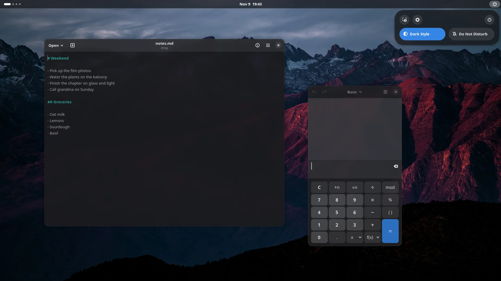
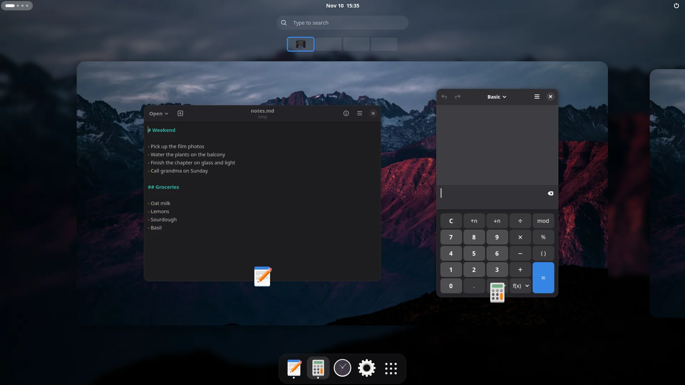
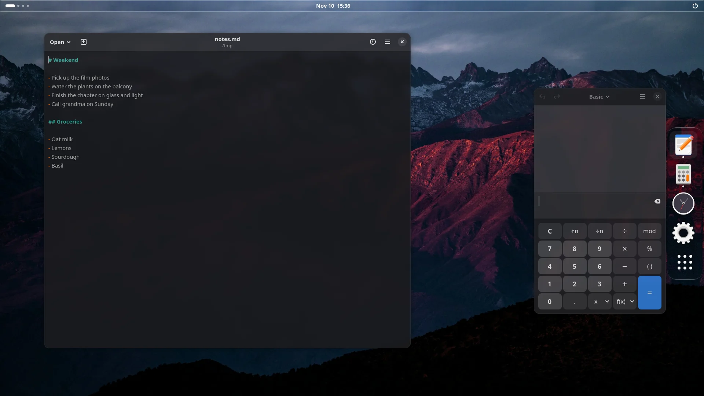
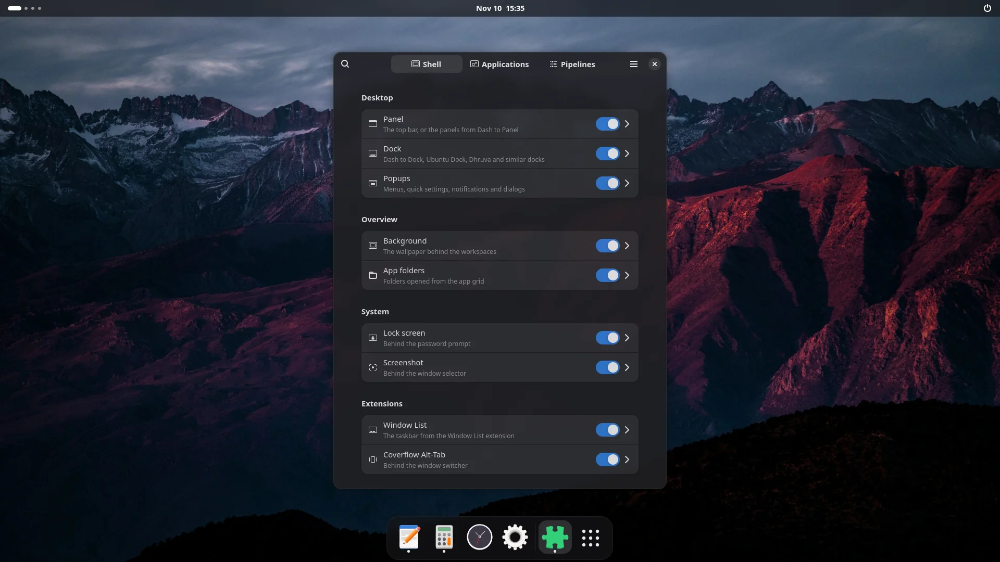

# Blur my Shell

[](https://extensions.gnome.org/extension/3193/blur-my-shell/)

[](https://github.com/aunetx/blur-my-shell/blob/master/LICENSE)
[](https://github.com/aunetx/blur-my-shell/releases/latest)
[](https://hosted.weblate.org/engage/blur-my-shell/)

Blur my Shell adds blur to GNOME Shell: the top panel, the dash and overview, menus and notifications, the lock screen, and the windows of your applications. Every blur is made of effects you can tune, from a simple blur to Liquid Glass.



## What it blurs

- **Panel**, with a transparent, light or dark background over the blur. It can switch the blur off in the overview, or when a window touches the panel.
- **Dock**, whether it's the dash of the overview or a dock extension.
- **Overview**, behind the workspaces and between them, and the app folders.
- **Popups**: panel menus, quick settings, the calendar, notifications, on-screen displays, switchers and dialogs. You choose which ones, and each kind has its own corner radius.
- **Applications**, behind their windows and their menus. Blur every window except the ones you exclude, or only the ones you list.
- **Lock screen** and the **screenshot** window picker.



## Static and dynamic blur

Static blur blurs a copy of the wallpaper. It's drawn once, so it costs almost nothing, but it only ever shows the wallpaper. Dynamic blur blurs whatever is actually behind the component, windows included, and follows them as they move. The panel, docks, popups and applications let you pick either one.

## Pipelines

Each part of the shell uses a pipeline: a list of effects applied one after the other. Blur my Shell comes with a few ready to use, like Liquid Glass and Vapor Glass, and you can build your own from these effects:

- Dual Kawase blur and Liquid Glass
- color and luminosity
- noise, pixelize, image and Vapor Wave

A component can use a different pipeline in light and dark mode. Pipelines and settings can be exported to a file from the preferences, to back them up or share them.



## Works with

- [Dash to Dock](https://extensions.gnome.org/extension/307/dash-to-dock/), Ubuntu Dock, [Dhruva](https://extensions.gnome.org/extension/9495/dhruva/), Simple Taskbar's dock, [Dock!ng](https://extensions.gnome.org/extension/8682/dockng/) and other docks built on the native dash
- [Dash to Panel](https://extensions.gnome.org/extension/1160/dash-to-panel/) and [Multi Monitor Bar](https://extensions.gnome.org/extension/8773/multi-monitor-bar/)
- [Hide Top Bar](https://extensions.gnome.org/extension/545/hide-top-bar/)
- [Window List](https://extensions.gnome.org/extension/602/window-list/) and [Coverflow Alt-Tab](https://extensions.gnome.org/extension/97/coverflow-alt-tab/)
- [Desktop Cube](https://extensions.gnome.org/extension/4648/desktop-cube/), which shows the blur between workspaces
- [Just Perfection](https://extensions.gnome.org/extension/3843/just-perfection/), [Panel Corners](https://extensions.gnome.org/extension/4805/panel-corners/) and [Burn my Windows](https://extensions.gnome.org/extension/4679/burn-my-windows/)

Extension developers can have their own surfaces blurred, or match Blur my Shell's look, as described in [the integration guide](docs/extension-integration.md).



The wallpaper in the screenshots is [Red highlands](https://unsplash.com/photos/JgOeRuGD_Y4) by John Towner, on Unsplash.

## Installing

Install it from [extensions.gnome.org](https://extensions.gnome.org/extension/3193/blur-my-shell/). Blur my Shell supports GNOME Shell 46 to 51.

The version on extensions.gnome.org is often a few fixes behind GitHub. To try the latest one, you need `git`, `make`, `gettext` and `glib-compile-resources` (in `glib2-devel` on Fedora and `libglib2.0-dev-bin` on Debian and Ubuntu):

```sh
git clone https://github.com/aunetx/blur-my-shell
cd blur-my-shell
make install
```

Then log out and back in. To update it later, run `git pull && make install` in the same folder. A version installed this way isn't updated by extensions.gnome.org; to go back to the released one, install it from there again.

If you installed the rounded-blur library for an older version, it isn't needed anymore: see [how to remove it](docs/rounded-blur-removal.md).

### Older GNOME versions

| GNOME Shell | Blur my Shell |
|---|---|
| 45 | version 58, `v58` tag |
| 43 and 44 | version 47, `v47` tag |
| 40 to 42 | version 29, `v29` tag |
| 3.36 and 3.38 | `pre_40` branch |

## Reporting issues

Before opening an issue, please check that it still happens with the latest version from GitHub, and search the open and closed issues in case someone already reported it. Keep to one problem per issue and fill in the template, especially the versions and the steps to reproduce it.

Questions, help with your setup and ideas that aren't fully formed yet are better suited to the [discussions](https://github.com/aunetx/blur-my-shell/discussions).

## Contributing

You can help translate Blur my Shell on [Weblate](https://hosted.weblate.org/engage/blur-my-shell/).

[](https://hosted.weblate.org/engage/blur-my-shell/)

To work on the code, `make test-shell` starts a disposable GNOME Shell session that doesn't touch your desktop settings: nested or devkit from your session, or native from a TTY, where `alt+f2` then `debugexit` exits it. In Looking Glass (`alt+f2`, then `lg`), the extension is available as `global.blur_my_shell`.

To read the logs:

```sh
# debug logs, when Debug Logging is enabled in the preferences
journalctl -b /usr/bin/gnome-shell | grep "Blur my Shell"

# errors in GNOME Shell
journalctl -b /usr/bin/gnome-shell | grep blur-my-shell

# errors in the preferences
journalctl -b /usr/bin/gjs | grep blur-my-shell
```

## Special thanks


Much much love to (I hope I did not forget anyone...):

- @yozoon, who is the basis of this work thanks to the [Blyr extension](https://github.com/yozoon/gnome-shell-extension-blyr)
- @a-parhom, who really permitted us to have a good static blur method, and especially to have corners!
- @JugadK who is the person behind using custom effects, and thanks to who you can have a crafted-to-your-will GNOME Shell
- @DaPigGuy who permitted the extension to continue after GNOME 45, by doing the egregious porting work :)
- @CorvetteCole for his awesome contributions, especially for the applications blur :p
- @RichardLuo0 who permitted to change the panel background colour
- @a2leexx who fixed important issues regarding dynamic blur
- @io12 thanks to which applications blurring works well enough for it to be usable
- @Schneegans thanks to whom a lot is coming from actually, because its code is so crystal-clear that it helped me during my development (that is the case of many other extensions developers by the way!!)
- @TomBursch thanks to which panel blur can be deactivated when windows are close to it
- @defkev who helped to work on GNOME 46
- @swyknox for the awesome icon!
- the translators, which I can't name here because there are quite a lot actually!
- every contributor, and even those who open these ugly issues!!! Because that's maybe the most important of it all :)

And lastly, thank you, kind visitor — this is a fun project to manage :)

## License

This program is distributed under the terms of the GNU General Public License, version 3 or later.
